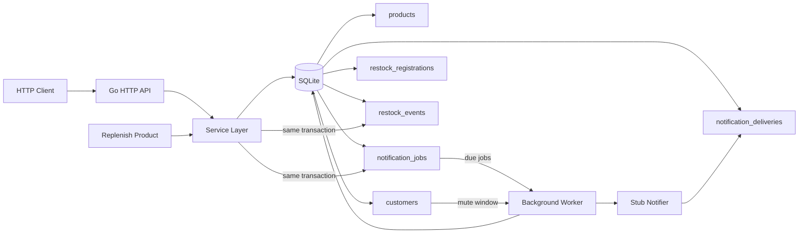

# Restock Notification System Design

## Context

This project is a Go interview implementation built from scratch in the current repository. It uses SQLite as the underlying relational database. The goal is to demonstrate reliable restock notifications without external infrastructure.

The system exposes an HTTP JSON API and runs a background worker in the same binary. Notifications are sent through a stub notifier and recorded in SQLite so tests and demos can verify delivery behavior.

## Requirements

- Customers can register for a restock notification for an out-of-stock product.
- Once a product is replenished, all registered customers are notified.
- Notifications must not be missed.
- Notifications must not be duplicated.
- Customers can mute notifications during a daily time window, including windows that span midnight.
- Muted notifications are deferred and delivered after the mute window ends.
- Registrations are one-shot: after a successful notification, the registration is complete and is not reused for future restocks.

## Recommended Approach

Use a transactional outbox stored in SQLite.

When a replenish request changes product stock from `0` to a positive value, the service creates a restock event and one notification job per active registration in the same database transaction. A background worker claims due jobs, respects mute windows, sends via the stub notifier, and records delivery.

This approach keeps the implementation small while directly addressing the reliability requirements. A synchronous send inside the replenish request is simpler, but a crash midway could miss customers or duplicate work. An in-memory queue is not acceptable because jobs disappear on process restart.

## Architecture

The service consists of four focused parts:

- HTTP handlers parse JSON requests, call service methods, and return JSON responses.
- Service methods enforce business rules and run database transactions.
- SQLite repositories store products, customers, registrations, restock events, notification jobs, and deliveries.
- A worker processes pending notification jobs in bounded batches.

The worker runs inside the same process for the demo. It also exposes a deterministic `ProcessBatch`-style method so tests can drive job processing without sleeps.

## Data Model

### `products`

Stores product identity and current stock.

- `id`
- `sku`
- `name`
- `stock`
- `created_at`
- `updated_at`

### `customers`

Stores customer identity and an optional daily mute window.

- `id`
- `email`
- `mute_start_minute`
- `mute_end_minute`
- `created_at`
- `updated_at`

Mute windows are stored as minutes since midnight in local demo time. A window such as `23:00` to `07:00` means muted from 23:00 through midnight until 07:00. A missing start or end means notifications are not muted.

### `restock_registrations`

Stores one-shot customer registrations for product restock.

- `id`
- `product_id`
- `customer_id`
- `status`: `active`, `queued`, or `notified`
- `created_at`
- `updated_at`

A customer cannot have multiple live registrations for the same product. After a notification job is created, the registration moves from `active` to `queued`. After successful delivery, it moves to `notified`.

### `restock_events`

Stores immutable restock events.

- `id`
- `product_id`
- `previous_stock`
- `new_stock`
- `created_at`

A restock event is created only when replenishment crosses from out-of-stock (`0`) to in-stock (`>0`).

### `notification_jobs`

Stores durable outbox jobs.

- `id`
- `registration_id`
- `restock_event_id`
- `customer_id`
- `product_id`
- `status`: `pending`, `processing`, `sent`, or `failed`
- `available_at`
- `attempt_count`
- `last_error`
- `created_at`
- `updated_at`

There is a unique constraint on `registration_id`, which enforces one notification job per one-shot registration. Jobs due in the future remain `pending` with `available_at` set to the time when they may be retried.

### `notification_deliveries`

Stores the stub notifier output.

- `id`
- `job_id`
- `customer_id`
- `product_id`
- `message`
- `sent_at`

There is a unique constraint on `job_id`, which makes delivery idempotent for a job.

## HTTP API

### `POST /products`

Creates a product with initial stock.

### `POST /products/{id}/registrations`

Registers a customer for notification when the product is out of stock. The request is rejected if the product currently has stock.

### `POST /products/{id}/replenish`

Increments product stock. If the stock crosses from `0` to positive, the transaction creates a restock event and notification jobs for all active registrations for that product.

### `PUT /customers/{id}/mute-window`

Sets or clears a customer's daily mute window.

### `GET /notifications`

Lists notification jobs and sent deliveries for demo and test verification.

## Reliability Semantics

"Not missed" means every active registration that is eligible at restock time gets a durable notification job in the same SQLite transaction as the restock event.

"Not duplicated" means each one-shot registration can result in at most one sent notification. This is enforced with:

- a unique constraint on `notification_jobs.registration_id`;
- a unique constraint on `notification_deliveries.job_id`;
- registration state transitions from `active` to `queued` to `notified`;
- worker logic that treats an existing delivery as successful idempotent completion.

If the process crashes after jobs are created but before delivery, jobs remain in SQLite and the worker can process them after restart. If the process crashes after recording delivery but before marking the job as sent, the unique delivery row allows the next worker run to mark the job as sent without sending a duplicate notification.

SQLite write concurrency is limited, but that is acceptable for this interview implementation. Database uniqueness is the source of truth for duplicate prevention.

## Mute Window Behavior

If a worker claims a job for a customer who is currently inside a mute window, it does not send the notification. It moves the job back to `pending` and sets `available_at` to the end of the current mute window.

Mute windows can span midnight. For example, a window from `23:00` to `07:00` mutes times greater than or equal to 23:00 or less than 07:00.

## Testing Strategy

Implementation will follow TDD. Tests will use SQLite and real service code, with the stub notifier writing to `notification_deliveries`.

Core tests:

- registering succeeds for an out-of-stock product;
- registering is rejected for an in-stock product;
- replenishment from `0` to positive creates one restock event and one job per active registration;
- repeated replenish calls do not create duplicate jobs for completed one-shot registrations;
- worker processing sends each due job exactly once;
- replaying worker processing after delivery does not duplicate a notification;
- jobs for muted customers are deferred, not skipped;
- midnight-spanning mute windows are evaluated correctly.

## Out Of Scope

- Real email, SMS, push, or webhook delivery.
- Authentication and authorization.
- Multi-tenant product catalogs.
- Distributed workers.
- MySQL/InnoDB-specific locking behavior.
- A production UI.
